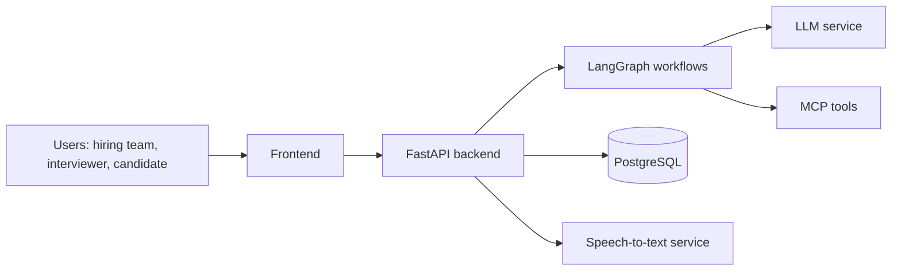

# RecruitO


**Name rationale:** I chose the name RecruitO because it combines “Recruit” with a modern, technology-driven identity, reflecting the goal of making recruitment smarter and more efficient. The platform serves recruiters, interviewers, and hiring managers by helping them screen and rank candidates, conduct AI-powered interviews, and generate evidence-based candidate assessments. Recruito, the name sounds like a pet which does the recruitment for you.

> Status: **work in progress.** See [Project Status](#project-status) for what is implemented and what still needs verification.

---

## Table of Contents

1. [Overview](#overview)
2. [Features](#features)
3. [Architecture](#architecture)
4. [Technology Stack](#technology-stack)
5. [Prerequisites](#prerequisites)
6. [Setup and Run](#setup-and-run)
7. [Configuration Reference](#configuration-reference)
8. [Usage Walkthrough](#usage-walkthrough)
9. [API Documentation](#api-documentation)
10. [Privacy and Data Handling](#privacy-and-data-handling)
11. [Project Documentation](#project-documentation)
12. [Project Status](#project-status)
13. [Known Limitations](#known-limitations)

---

## Overview

Recruitment teams receive far more applications than they can assess consistently. Screening is shallow, interviewers apply different standards, and interview content is lost in unstructured notes.

RecruitO supports the hiring workflow end to end:

| Stage | What RecruitO does |
|---|---|
| **Pre-interview** | Accepts PDF/DOCX applications and hiring-manager batch imports of up to 50 CVs. Every CV is scored automatically with quoted evidence per requirement and ranked per job. Live LLM and 20-CV verification remain pending. |
| **During interview** | Emails the hiring manager when a candidate is interview-eligible; the manager assigns the date, time, and interviewer, and RecruitO emails the candidate and interviewer the confirmed details, an `.ics` attachment, and expiring role-scoped links to the browser interview room. TURN relay and two-browser verification remain pending. |
| **Post-interview** | With participant consent, captures transcript segments, analyzes interview evidence, and provides printable consolidated reports. Schema migration is applied; live provider and browser verification remain pending. |

RecruitO is designed to **augment human decision-making, not replace it**. Every AI-generated score or flag is explainable and traceable to CV content or a transcript segment.

---

## Features

### Core

| # | Feature | Status |
|---|---|---|
| F1 | CV screening and requirement-based candidate ranking | Implemented: PDF/DOCX extraction, single and batch (up to 50) intake, per-file failure isolation, semantic requirement matching, ranking with a skills-then-experience tie-breaker. Live 20-CV run pending |
| F2 | AI-based candidate scoring (configurable weights, per-dimension justification) | Implemented: per-requirement weights (1–5), category scores with justifications built from stored evaluations, quoted CV evidence verified against the CV text, deterministic decoding and a versioned score cache. Live LLM validation pending |
| F3 | AI-powered video interview | Partial: manager-assigned interview date/time and interviewer, WebRTC room, optional F7 panel; two-browser verification remains |
| F4 | Speech capture and transcription | Partial: consented 3.5-second audio chunks sent for transcription; transcript text stored; live provider and browser verification pending |
| F5 | Interview question and answer analysis | Partial: analysis graph, structured Q&A, requirement mapping, transcript references, and unexplored requirements |
| F6 | Consolidated candidate assessment (export and comparison) | Partial: manager report, comparison view, and browser print output; live validation pending |

### Core — Job description drafting and external publishing (F11)

**Recruitment workflow assistant and external job publishing (must-have).** RecruitO drafts policy-checked job descriptions with a manager-facing assistant and can publish approved jobs to Blogger through a bundled MCP service. Blogger posts link back to RecruitO's application form; public job cards show only the job title and seniority.

### Innovation Feature — Privacy-Scoped, Role-Aware AI Assistant

**A conversational assistant that is private by construction, not just by instruction.** RecruitO's innovation feature is an AI assistant that lets each signed-in user ask natural-language questions about the hiring process — yet it is *structurally* unable to reveal data outside that user's permission. Privacy and role isolation are enforced at two layers:

- **Structural guardrails (the primary protection).** The assistant answers only through a per-role allowlist of database tools, and every tool is **bound to the authenticated user's id on the server** — never taken from the model's output or the client. A candidate's tools query only that candidate's own applications (`WHERE candidate_id = <signed-in user>`); an interviewer's transcript tool refuses any interview not assigned to them; a candidate's session is never even handed a staff tool. Because the model is never given a tool that can reach another user's data, a jailbreak or a malicious CV/transcript cannot exfiltrate it.
- **Prompt guardrails (defence in depth).** Every turn carries an instruction to use only role-authorized tools, treat all user, CV, and transcript text as **untrusted data** (prompt-injection defence), never change its own permissions, never claim a hiring decision or an automated rejection, and admit when a tool result does not answer the question.

The **same role-aware engine serves candidates, interviewers, and hiring managers**, each scoped to their own role and identity — one assistant, many trust boundaries. Role boundaries are exercised with the Day-8 red-team checklist ([`docs/Day8_Chatbot_RedTeam.md`](docs/Day8_Chatbot_RedTeam.md)), and the rationale is documented in [`docs/Innovation_Rationale.md`](docs/Innovation_Rationale.md).

**Why it is innovative:** most LLM assistants rely on the prompt alone to stay in bounds, which prompt injection can defeat. RecruitO moves the boundary into the **tool layer**, so data-access rules hold regardless of what the model is persuaded to say or do — privacy and role isolation are a property of the architecture, not of the wording of a prompt.

### Stretch Features Attempted

F7 has an optional candidate dashboard enrollment and one-frame interview match. Only an embedding is stored, consent can be revoked, and expiry is enforced by the Compose worker. This remains a prototype pending trainer/privacy approval and two-browser verification. F8 to F10 have source implementations for CV claim follow-up, weighted interview dimensions, and interviewer quality measures; provider and database verification remain pending.

---

## Architecture

The browser frontend calls the FastAPI API. PostgreSQL stores job, candidate, interview, score, audit, notification, and consent records. LangGraph coordinates job drafting, role-aware assistants, CV scoring, and application ranking. Gemini handles job drafting, chat, requirement-level CV assessment, transcript chunk transcription, and interview assessment. OpenCV YuNet/SFace matching runs locally in the API container. Email is delivered through the configured SMTP server.



### LangGraph workflows

| Graph | Purpose | Status |
|---|---|---|
| JD Graph | Retrieve policies, draft JD, extract requirements, check policy, retry, persist | Implemented |
| Manager job-chat graph | Analyse the manager's conversation, validate the job brief, and generate a job draft when it is complete (then optionally publish to Blogger) | Implemented |
| Role assistant graph (the candidate/interviewer/manager assistant) | Candidate: own applications and public jobs. Interviewer: assigned interviews and their transcripts. Manager: jobs, job profiles, ranking, consolidated assessments, and schedule | Implemented with per-role, user-bound database tools; this is the single engine behind the innovation feature. Red-team/provider verification pending |
| CV Assessment | Load inputs → extract text → evaluate → persist. A conditional edge re-runs evaluation up to three times when the model's output is malformed or quotes evidence that is not in the CV, then rejects to the queue's backoff retry | Implemented; live provider verification pending |
| Application ranking | Load scored applicants → rank by total score, then skills and experience points | Implemented |
| Interview Analysis | F5 analysis, persist result, then conditionally evaluate and persist F8-F10 when the CV is readable | Partial; live provider and database verification pending |

---

## Technology Stack

| Layer | Technology | Why |
|---|---|---|
| Backend | Python, FastAPI, Pydantic | Mandated; typed request and response models with automatic OpenAPI docs. |
| AI orchestration | LangGraph | Mandated; the workflows are multi-step and stateful. |
| Database | PostgreSQL | Relational data (candidates, sessions, transcripts, assessments) with strong integrity. |
| Containers | Docker, Docker Compose | Mandated; one-command reproducible startup. |
| Frontend | HTML, CSS, and JavaScript modules | Small static frontend, served by Nginx in Docker Compose. |
| Video | Browser WebRTC, FastAPI WebSocket signalling | Peer media stays in browsers; the backend relays signalling and optional consented identity frames. TURN is not configured. |
| Speech-to-text | Google Gemini audio understanding | Short consented audio chunks are sent to Gemini; this is chunked transcription, not low-latency streaming. |
| Face detection and matching | OpenCV YuNet and SFace | Optional candidate opt-in; models run on the API host, embeddings expire after 30 days, and photos/frames are not retained. |
| LLM provider | Google Gemini API | Job drafting, CV scoring, chat, transcription, and interview assessment use Gemini models. |

---

## Prerequisites

- Docker and Docker Compose
- Git
- API keys for the external services used (see [Configuration Reference](#configuration-reference)), supplied via environment variables

No local Python installation is required to run the application.

---

## Setup and Run

```bash
# 1. Clone the repository
git clone <repository-url>
cd recruito

# 2. Create your environment file, then set GEMINI_API_KEY and JWT_SECRET_KEY in it
cp .env.example .env

# 3. Build and start everything
docker compose up --build

# 4. In a second terminal, create the hiring-manager account from HIRING_MANAGER_* in .env
docker compose exec api python -m app.scripts.seed_staff
```

`.env.example` ships working local database defaults, so only the Gemini key and JWT secret are required for a local run. Without a Gemini key the application still starts, and AI features report that they are not configured. The API container runs `alembic upgrade head` before FastAPI.

Once running:

| What | Where |
|---|---|
| RecruitO frontend | http://localhost:5500 |
| API health check | http://localhost:8000/health |
| Interactive API docs (OpenAPI) | http://localhost:8000/docs |

### Common commands

```bash
# Stop the application (data is kept)
docker compose down

# Start again without rebuilding
docker compose up

# View logs
docker compose logs -f api

# Full reset: stops everything AND deletes the database volume
docker compose down -v
```

### Batch CV screening and the 20-CV timing run (N1)

Hiring managers can import up to 50 PDF/DOCX CVs for an approved job from **Jobs and applicant rankings → Import a batch of CVs for screening**, or with `POST /jobs/{job_id}/applications/batch`. Each file is validated and stored independently, so an unreadable or duplicate CV is reported without stopping the batch. Imported CVs belong to non-login candidate records with a reserved `.invalid` address, so RecruitO never emails them or offers them interview times; they are for screening and ranking.

To measure N1, put the sample CVs in `test-data/sample-cvs/` (git-ignored; never commit them) and run:

```bash
docker compose exec api python -m app.scripts.import_cvs --job-id <approved job id> /data/test-data/sample-cvs
```

The script imports every CV, runs screening to completion with `SCREENING_CONCURRENCY` parallel model calls, and prints the import time, the total parse-screen-score-rank time, the time per CV, and the resulting ranking. Record the figure in [Measured performance](#measured-performance).

**Rescoring.** Scores are never edited by hand. `POST /admin/applications/{id}/rescore` and `POST /jobs/{job_id}/rescore` (both need a written reason and are audit-logged) queue a new score version against the job's current requirements and keep earlier versions. Unchanged inputs reuse the stored score, which keeps results reproducible.

### Blogger job posting

Approved jobs can be emailed to Blogger from the hiring workspace using Mail2Blogger. The post includes the job description and a link to the RecruitO application form. Configure Blogger's private Mail2Blogger address and the existing SMTP settings in `.env`. The bundled Streamable HTTP MCP service sends the email. Mail2Blogger creates a new post each time and does not return a post-specific URL, so candidate cards link to the blog homepage. See `docs/blogger_setup.md` for setup details.

### Manager-driven interview scheduling

New applications are queued for automatic CV assessment. A completed latest score strictly above 65/100 makes the candidate eligible for an interview; lower scores do not automatically reject the candidate. When an application becomes eligible, RecruitO emails the hiring manager that the candidate is ready to interview, with a link into the hiring workspace. The manager opens the application and assigns an interview **date and time** (a standard browser date-and-time picker) and an **interviewer** from a dropdown of active interviewers. RecruitO then stores the interview and emails the candidate and the interviewer the confirmed details, an `.ics` calendar attachment, an "add to calendar" link, and the candidate's and interviewer's role-scoped join links. The manager can reschedule or reassign later, and still makes the final hiring decision.

There is no external calendar integration and no OAuth to configure: the manager is the scheduling authority, and the only requirement is at least one active interviewer account (created from **Create a staff account**). Email delivery uses the SMTP settings described above.

---

## Configuration Reference

All configuration is provided through environment variables. Copy `.env.example` to `.env`. Never commit `.env`.

| Variable | Description |
|---|---|
| `POSTGRES_USER` | Database user |
| `POSTGRES_PASSWORD` | Database password |
| `POSTGRES_DB` | Database name |
| `DATABASE_URL` | Connection string used by the API |
| `CORS_ORIGINS` | Exact browser origins permitted to access the API |
| `CORS_ORIGIN_REGEX` | Optional private-LAN frontend origin allowance for local development only; disable on untrusted networks |
| `FRONTEND_LAN_HOST` | Computer's LAN IPv4 address used to build the frontend Content Security Policy |
| `PUBLIC_BASE_URL` | Public HTTPS frontend URL used in Blogger application links |
| `BLOGGER_SITE_URL` | Public homepage URL for the Blogger blog |
| `BLOGGER_POST_EMAIL` | Private Mail2Blogger address configured in Blogger settings |
| `BLOGGER_MCP_URL` | Internal URL for the Blogger MCP service in Docker Compose |
| `SMTP_HOST`, `SMTP_PORT`, `SMTP_USERNAME`, `SMTP_PASSWORD`, `SMTP_FROM_EMAIL` | SMTP sender configuration, also used for application receipt emails |
| `GEMINI_API_KEY` | Google Gemini API key for JD/chat graphs, CV scoring, transcription, and assessments |
| `SCORING_MODEL` | Gemini model name used by CV scoring |
| `SCREENING_CONCURRENCY` | Parallel CV scoring calls per worker cycle (default 4); lower it if the Gemini quota is reached |
| `CHAT_MODEL`, `ASSESSMENT_MODEL`, `TRANSCRIPTION_MODEL` | Gemini models used by role chat, interview assessment, and consented chunk transcription |
| `FACE_MODELS_DIR` | Directory for the SHA-256-pinned YuNet and SFace model files |
| `APP_ENV` | Set to `development` to expose the development-only mock-transcript route |
| `APP_MAIL_*` | Fallback SMTP transport for queued status/interview emails, used only when `SMTP_HOST` is blank |
| `JWT_SECRET_KEY`, `ACCESS_TOKEN_EXPIRE_MINUTES`, `COOKIE_SECURE` | Session-signing key, session lifetime, and HTTPS cookie setting |

---

## Usage Walkthrough

1. Sign in as a hiring manager, prepare a job with the job assistant, then review and approve it.
2. Share the public application link. Candidates create an account, submit the application form, and upload a PDF or DOCX CV. To screen a stack of CVs at once, use the batch import in the job's ranking panel.
3. RecruitO scores the CV. When a score is above 65/100, RecruitO emails the hiring manager that the candidate is ready to interview. The manager reviews the candidate evidence and ranking, then assigns an interview date, time, and interviewer; RecruitO emails the candidate and interviewer the confirmed details and join links.
4. Candidate and interviewer join with their role-scoped links. Audio transcription and biometric matching are separate optional consent choices.
5. Review the saved transcript and run interview analysis. Open the printable assessment and compare candidates.
6. To publish through Blogger, configure the private Mail2Blogger address, SMTP settings, and public HTTPS application URL as described in `docs/blogger_setup.md`.

All assessment output is decision support. Hiring decisions remain with people.

---

## API Documentation

The API is documented through OpenAPI. With the application running, open http://localhost:8000/docs.

---

### Job Description Agent

The JD Agent creates a job description draft from role details, checks it against the stored hiring policies, extracts structured requirements, and saves it for human review.

- `POST /jobs/generate` — submit the role title, seniority, key skills, employment type, and location mode. Returns the saved job ID.
- `GET /jobs/{job_id}` — retrieve the draft and its requirements.
- `PUT /jobs/{job_id}` — replace the JD text and full requirements list after review.
- `POST /jobs/{job_id}/approve` — mark a draft as approved.

The generation graph retrieves relevant policy chunks, drafts the JD, extracts requirements, and checks the draft and requirements. If the checker finds issues, it can send the draft back for up to two retries. Open `/docs` while the API is running to try the endpoints.

## Privacy and Data Handling

RecruitO processes personal data (names, contact details, employment history, voice). It is built with the following principles.

- **Demo data.** Use synthetic data for development and presentation. Applications contain personal data and uploaded CVs; do not use real candidate data without an approved retention and access policy.
- **Nothing personal in the repository.** CVs, recordings, transcripts and database dumps are git-ignored. Demonstration material is anonymised.
- **Secrets via environment variables only.** No credentials are committed; `.env.example` contains placeholders.
- **Data minimisation.** CV files and profile/application answers persist in Postgres and the candidate-upload volume until deletion. With explicit consent from each participant, short microphone chunks are sent to Gemini for transcription and only transcript text is stored by RecruitO. A separate optional biometric consent stores only an SFace embedding for up to 30 days; source photos and match frames are processed in memory and not retained. The Compose worker deletes expired embeddings. Obtain trainer approval before using any real candidates' biometric data.
- **Third-party disclosure.** CV text, consented audio chunks, and job/chat/interview assessment prompts are sent to Google Gemini for the requested feature. Face detection and matching run locally in the API container using OpenCV YuNet/SFace. Email is delivered through the configured SMTP server using the supplied credentials. RecruitO no longer integrates with any external calendar service; interview times are entered by the hiring manager and shared only over email.
- **Deletion.** Hiring managers can delete candidate data via `DELETE /admin/candidates/{candidate_id}?reason=...`; the reason must contain at least 10 characters. Applications, scores, transcripts, consents, and the biometric embedding cascade, uploaded CV files are removed, and personal values in earlier audit entries are cleared.
- **Batch imports.** Imported CVs are stored like applications but have no inbox: their reserved `.invalid` addresses are never sent email, and they are excluded from automatic interview scheduling.
- **Fairness.** Scoring compares CV text to stated job requirements; it cannot eliminate bias in the criteria, CV language, or Gemini output. Scores support human review and do not make automated rejection decisions.

---

## Project Documentation

Located in [`docs/`](docs/):

- [Trainer clarification request and plan changes](docs/Trainer_Clarifications_and_Plan_Changes.md) — the project owner must obtain the trainer's written response.
- [Planned versus actual work](docs/Actual_vs_Planned.md) — actual hours have not been inferred.
- [Risk register](docs/Risk_Register.md)
- [Privacy and fairness notes](docs/Privacy_and_Fairness.md)
- [Innovation feature rationale](docs/Innovation_Rationale.md)
- [Day 8 chatbot red-team checklist](docs/Day8_Chatbot_RedTeam.md) — manual role-boundary checks; execution remains pending until the local API and Gemini service are available.
- Existing WBS workbooks, architecture diagrams, Blogger setup, learning log, and incremental progress record.

---

## Project Status

| Area | Status |
|---|---|
| Repository, Docker Compose, FastAPI, PostgreSQL | See [Verification record](#verification-record) |
| CV ingestion and parsing | PDF/DOCX upload, batch import (up to 50), and text extraction; 20-CV demonstration pending |
| F1, F2: screening, ranking, scoring | Implemented, including in-graph retry, rescoring, and versioned scores; live Gemini and 20-CV validation pending |
| F3: video interview | Signalling and interview UI implemented; two-browser verification pending |
| F4: transcription | Consent record, audio chunk capture, transcript storage, and schema applied; provider/browser verification pending |
| F5, F6: analysis, consolidated assessment | Analysis graph, report, comparison views, and schema applied; live provider validation pending |
| Interviewer role, manager-driven interview scheduling, outbox email, manager correction/status actions | Source implemented; live end-to-end checks pending |
| F7, F8-F10 | Source implemented and schema applied; trainer approval and live verification pending |
| Candidate assistant chatbot (innovation feature) | Candidate allowlist and manager/interviewer dashboard UI implemented; red-team and provider verification pending |
| F11: job description drafting & Blogger publishing (core) | Blogger MCP Mail2Blogger path exists and is configured; public posting flow not exercised |
| Hardening, documentation, clean-machine verification | 23 backend tests pass. Live provider/browser, 20-CV, mail, WebRTC, response timing, trainer clarification, rehearsal, and presentation checks remain |

### Verification record

| Check | Result |
|---|---|
| Backend unit tests (`python -m pytest` in `backend/`) | 23 passed: access rules, candidate data scoping, role chatbot allowlists, score calculation and evidence checks, batch-import validation and isolation, in-graph retry routing |
| API starts without `GEMINI_API_KEY` | Verified; AI features report that they are not configured |
| Live Gemini scoring, transcription, analysis | Pending: needs a real key |
| 20-CV timing (N1) | Pending: run `app.scripts.import_cvs` with the sample CVs |
| Two-browser WebRTC and microphone | Pending |

### Measured performance

| Measure | Figure |
|---|---|
| N1: 20 CVs parsed, screened, scored, and ranked | _Pending: record the `import_cvs` output here_ |
| N2: transcript latency (3.5-second chunks) | _Pending: measure in a two-browser session_ |

---

## Known Limitations

Known limitations:

- WebRTC signalling is in-memory, works only within one API process, and has no TURN relay, so restrictive NAT/firewalls can block calls.
- Scanned/image-only PDFs may not yield text and cannot be scored by the current extractor.
- Gemini output may vary across model versions. Scoring uses temperature 0, and matching CV hash, requirements version, prompt version, and model reuse a saved score.
- Batch-imported CVs have no candidate account, so they cannot join an interview; the person must apply through the job link to be interviewed. Display names come from the file name.
- Gemini chunk transcription does not provide a low-latency streaming experience. Short browser recordings are processed after each upload and timing is approximate.
- Interview analysis, reports, F7 biometric enrollment/matching, and F8-F10 have their schema migration applied; live provider verification and a two-browser demo remain. F7 is not a production identity decision and must never make or automate a hiring decision.
- OpenCV SFace model files add roughly 39 MB to the API image; the OpenCV headless wheel adds roughly 70 MB. OpenCV Zoo labels the SFace model directory Apache 2.0, while a public clarification request about this exact weight's training data and redistribution remains open; trainer review is required before real-candidate use.
- Interview-eligibility emails go to the hiring manager only for portal applicants whose latest CV score is above 65/100. The manager then assigns the time and interviewer manually; RecruitO does not read or write any external calendar and does not check attendee availability automatically.
- Scheduling needs at least one active interviewer account for the manager to assign. Interview times are shared by email with an `.ics` attachment and an "add to calendar" link.
