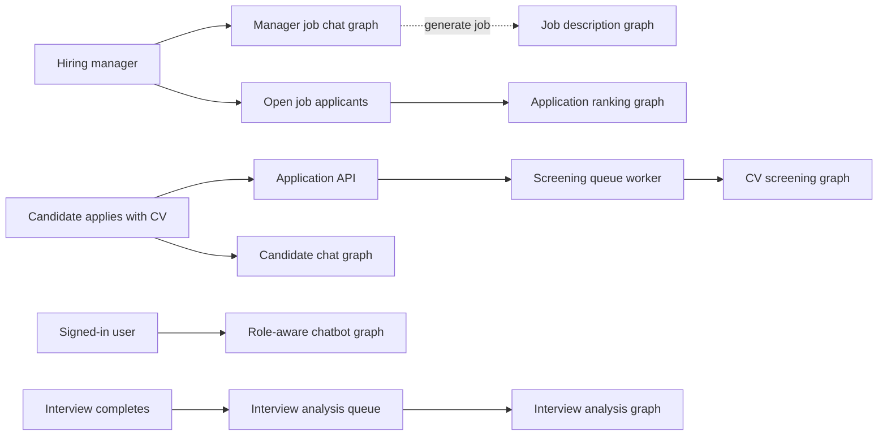
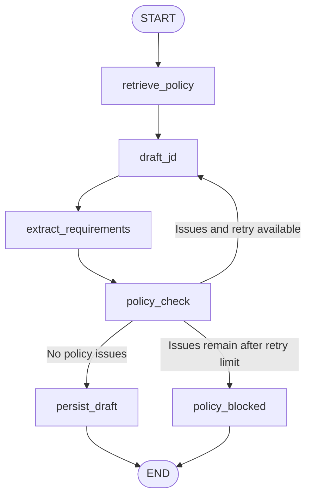
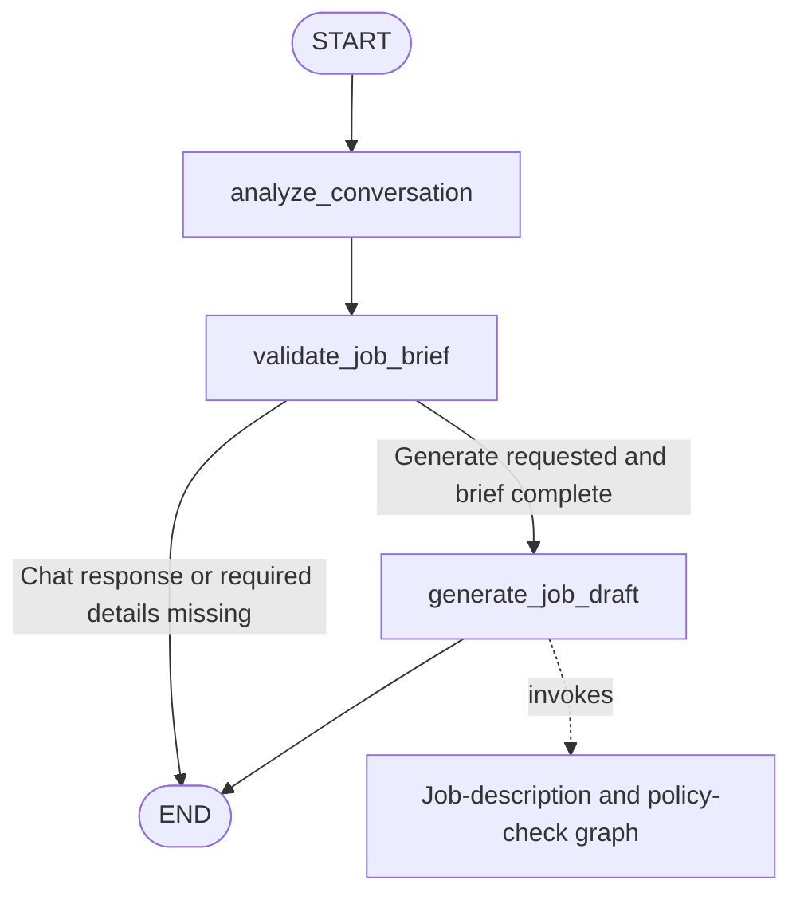
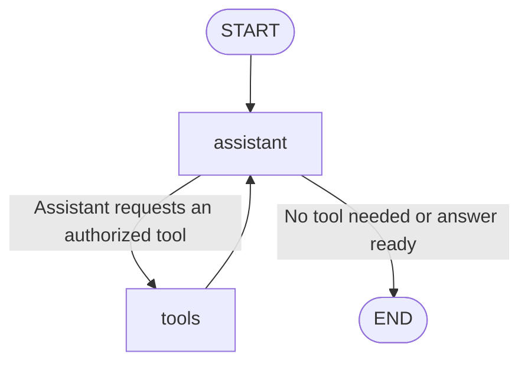
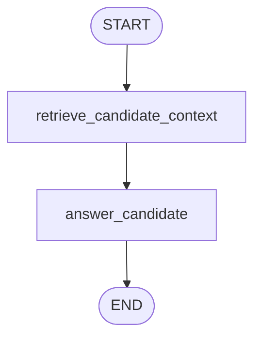
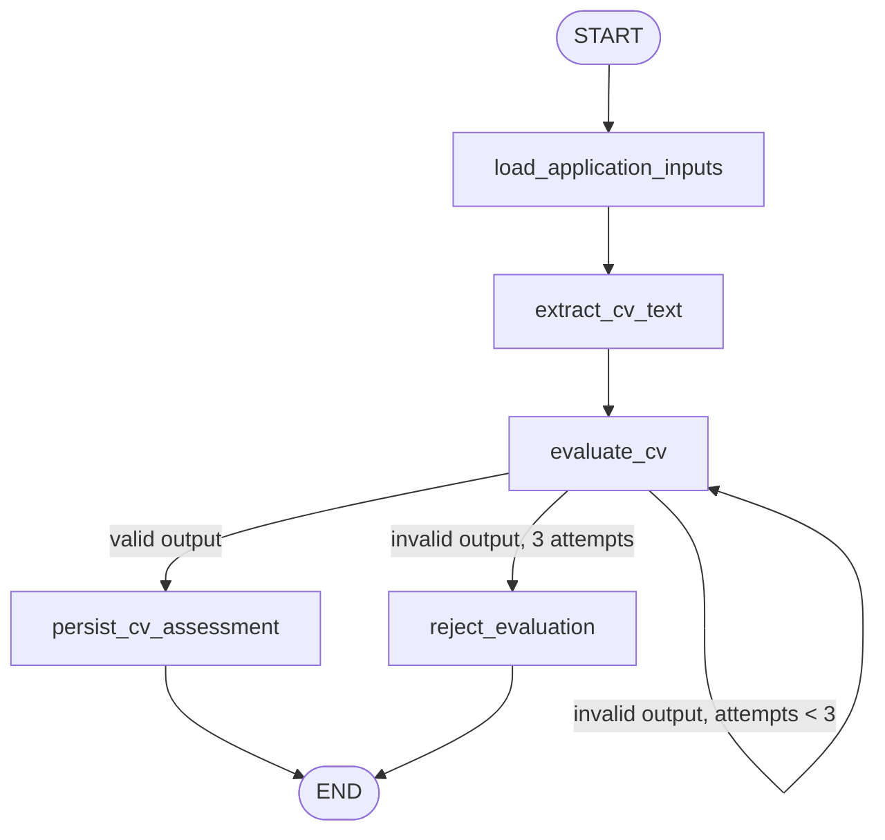
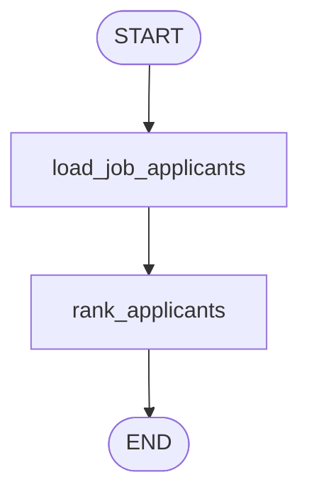
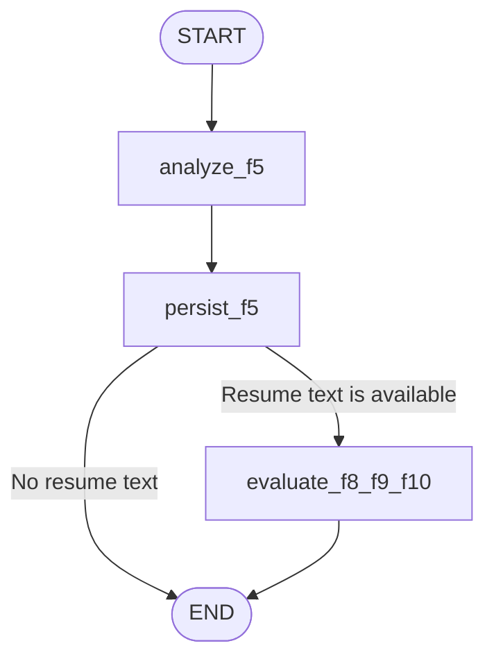

# RecruitO LangGraph Workflows

This reference documents every compiled LangGraph in `backend/app/graphs` as it is currently wired in the source code. Solid arrows are graph edges. Labeled branches are conditional edges. In the overview, dashed arrows show that an API, queue, or parent graph invokes another graph; those links are not edges in one giant LangGraph.

## Application-level workflow map

The job brief graph invokes the job-description graph when the manager has supplied the required details. CV scoring runs from the background screening queue after an application is submitted. Ranking runs when the manager application view or the hiring-manager chatbot requests applicants for a job. Interview analysis runs from its background queue after the interview is complete.

## 1. Job-description and policy-check graph

Source: [`jobDescription_graph.py`](../backend/app/graphs/jobDescription_graph.py)

- `retrieve_policy` fetches policy passages relevant to the role brief.
- `draft_jd` writes the job description; `extract_requirements` turns it into weighted, categorized criteria.
- `policy_check` validates the description and requirements. It loops to `draft_jd` while retries remain.
- A passing draft is saved by `persist_draft`. If checks still fail after the retry limit, `policy_blocked` ends the run without saving a job.

## 2. Hiring-manager job-brief chat graph

Source: [`manager_job_chat_graph.py`](../backend/app/graphs/manager_job_chat_graph.py)

`analyze_conversation` extracts the requested job details. `validate_job_brief` asks for missing information or stops after a normal chat turn. When generation is requested and the required fields are present, `generate_job_draft` invokes graph 1 and returns its result to the manager.

## 3. Role-aware chatbot graph

Source: [`role_chatbot.py`](../backend/app/graphs/role_chatbot.py)

The graph is built for the signed-in user's role and ID. The `tools` node only receives tools allowed for that role and user. It returns tool results to `assistant`, which then writes the response; without a tool call the graph ends.

## 4. Candidate status and job-help graph

Source: [`candidate_chatbot.py`](../backend/app/graphs/candidate_chatbot.py)

`retrieve_candidate_context` loads only the signed-in candidate's applications and interview times, plus approved public job cards. `answer_candidate` uses that context to answer the candidate. This graph retrieves its context from the application database; it is not the policy-vector retrieval workflow.

## 5. Automatic CV screening graph

Source: [`cv_screening_graph.py`](../backend/app/graphs/cv_screening_graph.py)

The graph loads the application, CV, job description, and requirements; extracts PDF or DOCX text; asks Gemini (temperature 0) for evidence-based requirement evaluations; and saves the weighted score, category breakdown, rationales, and evidence. `evaluate_cv` validates the model's answer in code: every requirement must be covered exactly once, statuses must be known, and every evidence quote must appear in the CV text. Invalid output is kept in state as `evaluation_error`, with `evaluation_attempts`, and the conditional edge re-runs the evaluation up to three times. After that, `reject_evaluation` raises `SCORING_OUTPUT_INVALID`, and the queue worker retries later with backoff. Input problems (missing CV, unreadable text, no requirements) fail permanently with a specific code. Batch-imported CVs (`scheduling_status = manual`) are scored and ranked but never queued for automatic interview invitations. The queue worker invokes this graph for submitted applications, batch imports, CV replacements, and manager rescoring, running up to `SCREENING_CONCURRENCY` graphs in parallel.

## 6. Per-job application ranking graph

Source: [`application_ranking_graph.py`](../backend/app/graphs/application_ranking_graph.py)

`load_job_applicants` gets each application's latest screening result for the selected job. `rank_applicants` sorts completed assessments by total score, then skills and experience scores as tie-breakers. Applications whose assessment is not complete are returned without a rank. The result supports manager review; it does not make advancement or hiring decisions.

## 7. Interview-analysis graph

Source: [`interview_analysis_graph.py`](../backend/app/graphs/interview_analysis_graph.py)

`analyze_f5` evaluates the interview transcript against job requirements. `persist_f5` saves that assessment. If resume text is available, `evaluate_f8_f9_f10` performs the extended evidence review and stores it; otherwise the graph ends after the first assessment. A failure in the optional extended review is recorded as a failed extended assessment while the completed F5 analysis remains available.

## Inventory

| Compiled graph | Builder/source | Main purpose |
|---|---|---|
| Job description and policy check | `jobDescription_graph.py` | Draft, validate, and save a role |
| Hiring-manager job-brief chat | `manager_job_chat_graph.py` | Gather role details and invoke job generation |
| Role-aware chatbot | `role_chatbot.py` | Answer role-specific questions and call authorized tools |
| Candidate status and job help | `candidate_chatbot.py` | Answer using the candidate's own applications and public job cards |
| Automatic CV screening | `cv_screening_graph.py` | Assess a submitted CV against a role |
| Per-job application ranking | `application_ranking_graph.py` | Order completed assessments for manager review |
| Interview analysis | `interview_analysis_graph.py` | Assess interview transcript and optional extended evidence |

